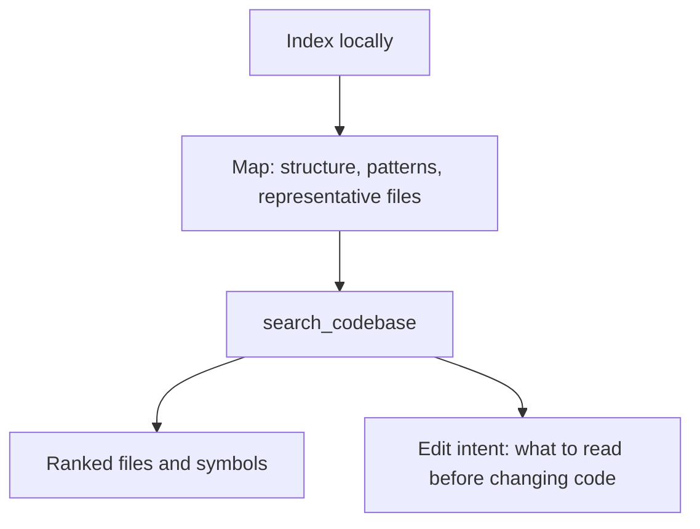
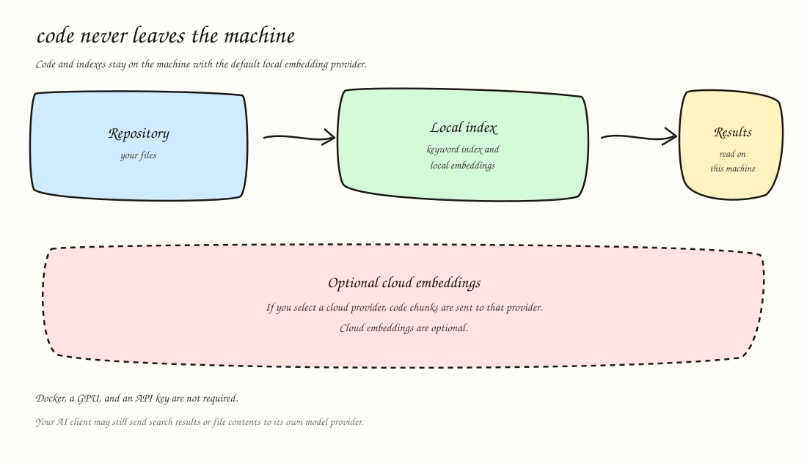

# Codebase Context

[](https://www.npmjs.com/package/codebase-context) [](./LICENSE) [](https://github.com/PatrickSys/codebase-context/blob/master/package.json)

Codebase Context gives coding agents a map of your repository through MCP, for developers who want their agent to find relevant code and follow the team's patterns. Search, examples and project memory run locally by default.

## Set up your AI client

Use Node.js 22 or newer. These commands use the current npm release of Codebase Context:

```bash
# Claude Code
claude mcp add --scope user --transport stdio codebase-context -- npx -y codebase-context

# Codex CLI (this is the Codex setup line)
codex mcp add codebase-context -- npx -y codebase-context

# OpenCode 1.x (keep the quoted separator on Windows)
opencode mcp add codebase-context '--' npx -y codebase-context
```

In the unreleased candidate, `--version` prints the installed package version and `map` builds a missing index before printing the map. A low-confidence search includes a hint that weak matches do not establish that code is absent. These additions require the built candidate; the unpinned commands above install published 2.2.0.

This repository's `init` command detects Claude Code, Codex, Cursor, and OpenCode and writes a project config for each selected tool. The saved launch is the Node binary and the package file from the npx cache. That command is in this source and is not part of published 2.2.0. Until it is published, use the copy-paste lines above. The [client setup guide](./docs/client-setup.md) marks the unpublished command.

Start a new agent session in your project, then ask:

> Use Codebase Context to find [feature] in this repository. Pass this repository's absolute path as project, wait for indexing if needed, and open the relevant source files.

Replace `[feature]` with something you want to find. The first run downloads a local model and indexes the repository; time depends on repository size, CPU and model.

### Planned for 2.4.0 (not yet published)

The unreleased source candidate starts new indexes without a model download. Semantic embeddings are optional; existing indexes keep their recorded mode. Its setup wizard can configure Claude Code, Codex, Cursor and OpenCode using the Node binary and package file that ran setup. These changes are not in the current npm release.

- NestJS support from community contributor Aaron Olin. See the [analyzer details](./docs/capabilities.md#analyzers).
- Better React/Next.js detection and a fix for reranker passage scoring.
- Transformers.js v4 for local models.

Known limits: [Intel Mac indexing crash (#68)](https://github.com/PatrickSys/codebase-context/issues/68), [custom OpenAI endpoints (#70)](https://github.com/PatrickSys/codebase-context/issues/70) and [Ollama (#71)](https://github.com/PatrickSys/codebase-context/issues/71) remain open.

The existing [benchmark](https://github.com/PatrickSys/codebase-context/blob/master/docs/benchmark.md) reports 25.7% expected-file recovery versus jCodeMunch's 27.1% in a fixed retrieval comparison; it does not establish a winner or coding quality.

For Codex Desktop, create or merge `.codex/config.toml` in the project you want to search:

```toml
[mcp_servers.codebase-context]
command = "npx"
args = ["-y", "codebase-context"]
startup_timeout_sec = 120
```

Trust the project if asked, restart Codex, and start a new task there. Use the prompt above. Config placement alone does not establish successful first use; this no-folder recipe has not been accepted in a fresh native Desktop task.

Other clients use their own setup commands:

| Client                      | Shortest current setup                                                       |
| --------------------------- | ---------------------------------------------------------------------------- |
| Gemini CLI                  | `gemini mcp add --scope user codebase-context npx -y codebase-context` |
| Cursor                      | Add `.cursor/mcp.json`                                                       |
| VS Code with GitHub Copilot | Add `.vscode/mcp.json`                                                       |
| GitHub Copilot CLI          | `copilot mcp add codebase-context -- npx -y codebase-context` |
| Windsurf                    | Add `~/.codeium/windsurf/mcp_config.json`                                    |

Check an existing same-name entry before replacing it. To give the server a default folder, append that folder's absolute path to the `npx` arguments. The [client setup guide](./docs/client-setup.md) covers scopes, optional fixed-folder configuration and the interactive setup wizard's limitations.

The [client setup guide](./docs/client-setup.md) has the exact commands and config for every client, plus what was checked locally and what still relies on official instructions.

The default connection is `stdio` (standard input/output): your client starts the server when it needs it. HTTP is an advanced, client-dependent option; verify the setup guide and client support before relying on it.

## What your agent gets

### Relevant code

`search_codebase` ranks files and symbols for the task instead of returning an unstructured dump. The agent can ask for a compact result first, then read the code it needs.

### Team patterns and examples

`get_team_patterns` shows the approaches used in the repository and points to representative files. Dedicated analyzers for Angular, React, and Next.js ship in published 2.2.0; NestJS support (along with React and Next.js detection improvements and a reranker fix) is planned for unpublished 2.4.0.

### Project memory

`remember` stores a convention, decision, gotcha, or past failure for the project. `get_memory` retrieves relevant entries in later sessions, including when the agent or editor changes.

### Review context

The `codebase-context-review` CLI creates a bounded context packet from a committed Git diff. It gives a reviewer context; it does not review code or prove review quality. See the [review-context guide](./docs/review-context.md).

## How it works

1. **Index locally.** Codebase Context scans the project, builds a keyword index, and creates local semantic embeddings - numeric representations used to match code by meaning as well as exact words.
2. **Understand the repository.** The agent can request a compact codebase map with structure, patterns, and representative files.
3. **Find the code for the task.** Search returns ranked files and symbols; the agent reads the selected files before editing.



The same information is available from the terminal. Run these commands from your project root. The first run downloads a local model and indexes the repository; time depends on repository size, CPU and model. Once it is ready, inspect the map and search for the code you need:

```bash
# Build or refresh the local index
npx -y codebase-context reindex

# Repository structure, patterns, and representative files
npx -y codebase-context map

# Ranked code search
npx -y codebase-context search --query "auth middleware"

# Current team patterns
npx -y codebase-context patterns
```

One stdio server can route across several repositories. Supply `project` in tool calls to select the intended repository; a successful selection becomes the default for later calls in that process. Some clients also announce workspace roots: one root can auto-select, while an ambiguous selection asks for a project instead of guessing. MCP deprecated Roots in its July 2026 revision, so explicit project selection is the documented default rather than a dependency on client discovery.

## See it

This recording is `map`, then `search --intent edit`, on the fixture in `tests/fixtures/codebases/eval-controlled`. The index was built off-camera with `reindex --no-embeddings`, and the screen is cleared before the search so the preflight stays in view. In this take the preflight says the match is low confidence and not ready to edit. A [WebM copy](./docs/assets/hero.webm) is the same take.


These are real CLI results from the open-source `angular-spotify` repository.

**Patterns and representative files**


The map shows the patterns found in the project, how common they are, and files that demonstrate them.

**Search before an edit**


The search result shows ranked files, relevant project patterns, and what the agent should read before it changes code.

More examples are available in the [CLI gallery](./docs/cli.md) and [walkthrough](https://github.com/PatrickSys/codebase-context/blob/master/docs/demo.md).

## Privacy

Code and indexes stay on the machine with the default local embedding provider. Docker, a GPU, and an API key are not required.



Cloud embeddings are optional. If you select a cloud provider, code chunks are sent to that provider to create the search index. The provider, model, project root, and local HTTP port can be changed through environment variables or the project config; see the [capabilities reference](./docs/capabilities.md).

This is the privacy boundary of Codebase Context itself. Your AI client may send search results or file contents to the model provider configured in that client. Codebase Context does not control that connection. If you commit and push `.codebase-context/memory.json`, the recorded project memory also travels with the repository.

Generated indexes belong in `.gitignore`. Project memory can be kept in version control when the team wants to share it:

```gitignore
.codebase-context/*
!.codebase-context/memory.json
```

## Evidence

Codebase Context runs locally through the Model Context Protocol (MCP), with indexed code kept on your machine by default.

Its ranked code search combines **Match words**, **Search by meaning**, and **Rank results** to give the agent ranked files, a best example, project patterns, relationships, and relevant memory before they edit.

The [benchmark](https://github.com/PatrickSys/codebase-context/blob/master/docs/benchmark.md) reports a corrected 100-attempt retrieval family across five local code-context tools: 99 completed attempts and 1 failed attempt. Codebase Context recovered 25.7% of expected gold files with 11.5% file precision in that fixed adapter run; jCodeMunch recovered 27.1% with 11.0% file precision. Raw-native is a deterministic lexical adapter here, not a full normal coding-agent baseline. These are retrieval observations, not a winner or a coding-quality claim. The [sanitized evidence extract](https://github.com/PatrickSys/codebase-context/blob/master/results/benchmark-presentation-evidence.json) records the exact values and source hashes.

The same report retains a separate 300-attempt repeatability history, a 30-run two-task full-agent pilot, and a metered replay whose tool-use validity remains unresolved. A historical Codebase Context indexing observation with embeddings enabled took about 12 minutes 31 seconds, but it does not establish warm-use speed, query latency, install cost, or a cross-tool index-speed ranking. The report does not combine these families into a pooled score and does not establish patch correctness or end-to-end coding quality. Earlier public reports are preserved separately in the [benchmark archive](https://github.com/PatrickSys/codebase-context/blob/master/docs/benchmark-prior-public-report.md).

The method and failures are documented so the measurements can be inspected with their limits.

## Limits

- Local semantic indexing does more work than a plain text index, especially on a fresh checkout and CPU-only machine.
- Retrieval measurements describe expected-file coverage, file precision, and reported `peakPrivateGb`, not patch correctness or end-to-end coding quality.
- The paired token observation covers two frozen investigation tasks and records observed agent behavior; it is not a universal token or time guarantee.
- Setup checks differ by client. The detailed guide distinguishes a written config, a config recognized by the client, a local connection, and instructions checked only against official docs.
- Dedicated Angular, React, and Next.js analyzers ship in published 2.2.0; NestJS support is planned for unpublished 2.4.0. Other projects use the generic analyzer and the language parsers available for that stack.
- The default searchable-chunk limit is 5,000 per project. Customizing this via `projects[].parsing.maxChunks` in `~/.codebase-context/config.json` requires 2.4.0 (not yet published).
- The agent must identify its repository in tool calls when no default or unambiguous client root is available. Concurrent HTTP client isolation is not established by the stdio routing checks.

## Reference

- [Client setup](./docs/client-setup.md#client-setup) - commands, config, proof level, and client limits
- [Capabilities](./docs/capabilities.md) - tools, response fields, routing, and configuration
- [CLI](./docs/cli.md) - terminal commands and example output
- [Benchmark](https://github.com/PatrickSys/codebase-context/blob/master/docs/benchmark.md) - method, measurements, and failures
- [Demo](https://github.com/PatrickSys/codebase-context/blob/master/docs/demo.md) - a complete repository walkthrough
- [Motivation](https://github.com/PatrickSys/codebase-context/blob/master/MOTIVATION.md) - the design problem and research background
- [Contributing](https://github.com/PatrickSys/codebase-context/blob/master/CONTRIBUTING.md) - local development and evaluation commands
- [Changelog](https://github.com/PatrickSys/codebase-context/blob/master/CHANGELOG.md) - release history

Elastic-2.0. See [LICENSE](./LICENSE).
